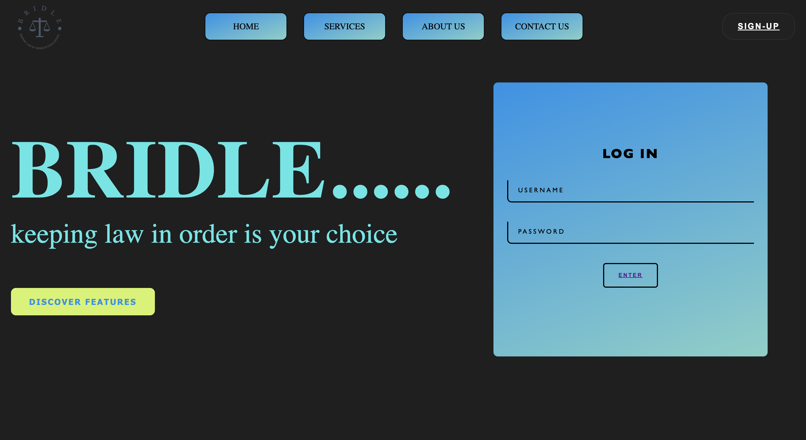
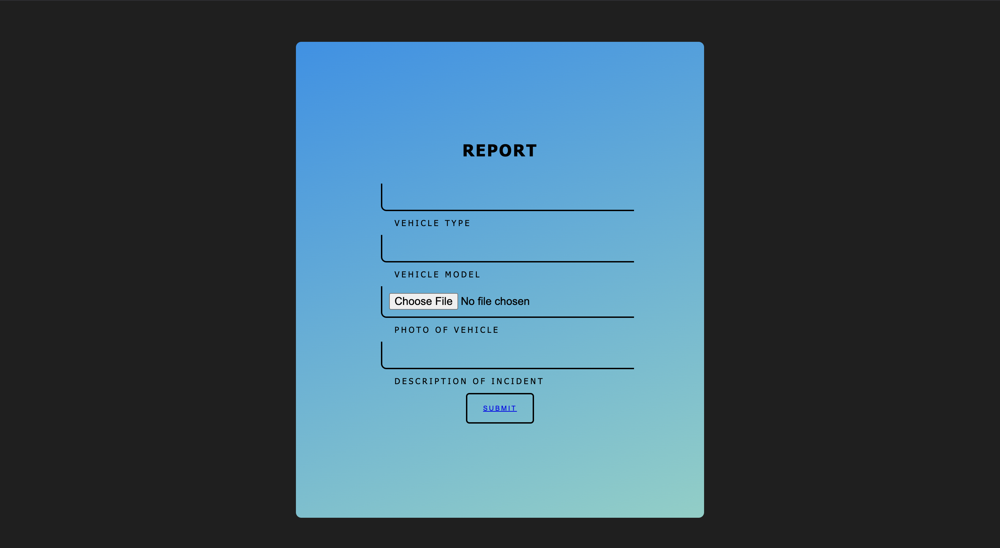

# Bridle - Static Website Project

This is my first coding project, a static website called Bridle. The site has a simple design focusing on law enforcement themes with a tagline "keeping law in order is your choice".

## Features

- Static website with basic UI
- Login page (non-functional)
- Report page for incidents
- Simple navigation menu

## Implementation Notes

- This is a static site with no backend functionality
- You can access the site by clicking the login button without filling in any credentials
- The report form doesn't process any data

## Screenshots

### Landing Page

### Report Form

This project was built to practice basic HTML/CSS skills as my first web development project.
